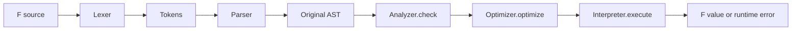

# F Language Interpreter

A hand-written lexer, recursive-descent parser, semantic analyzer, AST optimizer, and tree-walking interpreter for the small functional language **F**, implemented in Java 17 with Maven and JUnit 5.


## Table of Contents

- [Overview](#overview)
- [Requirements](#requirements)
- [Quick Start](#quick-start)
- [CLI Usage](#cli-usage)
- [Language at a Glance](#language-at-a-glance)
- [Runtime Semantics](#runtime-semantics)
- [Static Analysis and Optimizations](#static-analysis-and-optimizations)
- [Project Structure](#project-structure)
- [Testing](#testing)
- [Supported Subset and Limitations](#supported-subset-and-limitations)
- [License](#license)

## Overview

F is a small Lisp-style functional language. This project implements the complete pipeline from source text to runtime value:



- The **lexer** turns source text into positioned tokens.
- The **parser** builds an abstract syntax tree with one-based line and column positions.
- The **analyzer** performs read-only checks of names, scopes, arity, and partial types.
- The **optimizer** returns a safely rewritten tree without modifying the input tree.
- The **interpreter** executes the optimized tree in a fresh environment and reports positioned runtime errors.

All stages are implemented and covered by tests. The project also includes a CLI that prints every stage of the pipeline.

## Requirements

- **JDK 17** or newer
- **Apache Maven 3.8** or newer

Verify your environment:

```sh
java -version
javac -version
mvn -version
```

All commands below are run from the repository root, where `pom.xml` is located.

## Quick Start

Build and run the default example:

```sh
mvn -q -DskipTests package
java -cp target/classes f.Main
```

Run a program from the command line:

```sh
java -cp target/classes f.Main "(setq x 5) (times x x)"
```

Run every built-in demo:

```sh
java -cp target/classes f.Main --demo
```

Run the full test suite:

```sh
mvn clean verify
```

## CLI Usage

`f.Main` prints the source, token stream, original AST, semantic-check result, and optimized AST. After a successful check, it executes the optimized tree and prints the result:

```text
Result: 25
```

A failure during execution is reported with its position:

```text
Runtime error: Division by zero at 1:11
```

Static errors are reported before execution:

```text
Lexer error: ...
Parser error: ...
Analyzer error: Unknown identifier 'missing' at 1:7
```

A program with a semantic error is never optimized or executed.

### Examples

Function call:

```sh
java -cp target/classes f.Main "(func square (x) (times x x)) (square 5)"
```

```text
Result: 25
```

A runtime condition skips a failing branch:

```sh
java -cp target/classes f.Main "(setq flag false) (cond (flag (divide 1 0)) (else 7))"
```

```text
Result: 7
```

A loop accumulates values:

```sh
java -cp target/classes f.Main "(prog (i total)
  (setq i 1)
  (setq total 0)
  (while (less i 4)
    (setq total (plus total i))
    (setq i (plus i 1)))
  total)"
```

```text
Result: 6
```

A top-level `return` ends the program:

```sh
java -cp target/classes f.Main "(return 7) (divide 1 0)"
```

```text
Result: 7
```

A well-formed program can still fail at runtime:

```sh
java -cp target/classes f.Main "(divide 1 0)"
```

```text
Runtime error: Division by zero at 1:11
```

A static error is owned by the analyzer:

```sh
java -cp target/classes f.Main "(plus missing 1)"
```

```text
Analyzer error: Unknown identifier 'missing' at 1:7
```

### Optimizer Examples

```sh
java -cp target/classes f.Main "(not (and true false))"
java -cp target/classes f.Main "(cond ((not false) 8) (else 0))"
java -cp target/classes f.Main "(cond (false 1))"
```

Observed optimized trees and results:

```text
Program([true])
Result: true

Program([8])
Result: 8

Program([null])
Result: null
```

## Language at a Glance

### Literals and Names

- Integers: `123`, `-45`, `+7`
- Reals: `3.14`, `-0.5`, `+12.25`
- Booleans: `true`, `false`
- Null: `null`
- Identifiers: a Unicode letter followed by letters or digits, for example `plus`, `myFunc`, `greatereq`
- Comments: `// ...`

Function names such as `plus` and `times` are ordinary identifiers. A built-in name is recognized only in call-head position; otherwise it needs a binding.

### Special Forms

| Form | Syntax | Description |
|---|---|---|
| `quote` | `(quote expr)` or `'expr` | Produces a `QuoteExpr`; quoted contents are data |
| `setq` | `(setq name expr)` | Evaluates `expr`, then binds it in the current environment |
| `func` | `(func name (params) body)` | Defines a named function |
| `lambda` | `(lambda (params) body)` | Creates an anonymous function |
| `prog` | `(prog (locals) body)` | Creates a child environment with local names |
| `cond` | `(cond (test value) ... (else value))` | Clause-based conditional |
| `while` | `(while condition body)` | Loops while the condition is true |
| `return` | `(return)` or `(return expr)` | Exits the nearest `prog`, `func`, or `lambda` |
| `break` | `(break)` | Exits the nearest executing loop |

`cond` uses clause syntax `(cond (test value) ... (else value))`, not the positional form `(cond test then [else])` from the handout. The `else` clause is optional and must be last. A `cond` with no matching clause returns `null`.

### Grammar

```text
program     -> { expr } EOF
expr        -> atom | quoted | list
atom        -> IDENTIFIER | INTEGER | REAL | BOOLEAN | NULL
quoted      -> QUOTE expr
list        -> LPAREN KEYWORD special-form RPAREN
             | LPAREN expr { expr } RPAREN
```

An empty list `()` is a syntax error. Empty parameter and local-variable lists are allowed.

```text
number     ::= ['+' | '-'] digit+ [ '.' digit+ ]
identifier ::= letter (letter | digit)*
comment    ::= '//' [^\n]*
```

### Token Types

| Token type | Example | Description |
|---|---|---|
| `LPAREN` | `(` | Opening parenthesis |
| `RPAREN` | `)` | Closing parenthesis |
| `QUOTE` | `'` | Quote shorthand |
| `KEYWORD` | `lambda`, `setq` | Special form |
| `IDENTIFIER` | `head`, `myFunc` | Function or variable name |
| `INTEGER` | `123`, `-45`, `+7` | Integer literal |
| `REAL` | `3.14`, `-0.5` | Real literal |
| `BOOLEAN` | `true`, `false` | Boolean literal |
| `NULL` | `null` | Null value |
| `EOF` | end of input | End of the token stream |

## Runtime Semantics

Each call to `Interpreter.execute(Program)` starts with a fresh parent-linked environment. Lookup walks outward. `setq` evaluates its right side first and binds the value in the current environment.

### Values and Numbers

Runtime values are represented by `Value(Type, Object)`:

- Integers use `BigInteger`, so arithmetic is not limited by machine integer overflow.
- Reals use `BigDecimal`. Real literals parse and evaluate; real arithmetic is not implemented yet.
- Booleans and `null` have their own runtime types.
- Named functions are first-class runtime values.

The executed built-ins are `plus`, `times`, `less`, and `divide`. They require integer operands at runtime. `divide` performs integer division truncated toward zero and reports `Division by zero` at the divisor when the right side is zero.

### Scope and Functions

- `prog` creates a child environment. Declared locals hide outer names even before their first assignment; reading an uninitialized local is a runtime error.
- Named functions capture their defining environment. Each call evaluates arguments once, left to right, binds them in a fresh child environment, and executes the body there.
- Function bodies are deferred until a call. A function can be recursive because its name is registered before the body runs.

### Control Flow

- `cond` evaluates tests in order, requires a Boolean test result, and evaluates only the selected value. With no match it returns `null`.
- `while` rechecks its Boolean condition before every iteration, uses the surrounding environment, and always yields `null`.
- `return` exits the nearest active `prog` or named `func` (and `lambda` once lambdas are executable) and carries its value.
- `break` exits the nearest executing loop and skips the rest of that loop body.
- A `return` or `break` that reaches top level ends the program. A top-level `return` carries its value; a top-level `break` yields `null`.

### Runtime Errors

Runtime failures are reported as `InterpreterException` with a message and one-based `line:column` coordinates. Examples include division by zero, calling a non-function, wrong argument counts, non-integer arithmetic operands, and non-Boolean conditions.

Recognized features outside the interpreted subset, such as quoted lists, lambdas, and unsupported built-ins, produce a positioned diagnostic when execution reaches them. A quoted form is never executed accidentally.

## Static Analysis and Optimizations

The semantic stage runs after parsing and has two passes:


`Analyzer.check(Program)` is read-only. `Optimizer.optimize(Program)` returns a new tree and leaves the input tree unchanged. Checks always run first, so an optimization cannot hide a static error in a branch it would later remove.

### Analyzer Checks

- **C1 - Name resolution.** Definitely unknown identifier reads raise `AnalyzerException`. `setq` checks its value before defining its name. `func`, `lambda`, and `prog` create local contexts. Shadowing is valid. Function bodies are checked in isolated snapshots so later declarations remain possible.
- **C2 - Duplicate bindings.** Duplicate parameters or duplicate `prog` locals are errors. Reassignment is allowed.
- **C3 - Call arity.** Known built-ins, named functions, direct lambdas, and lambda values have their argument counts checked. The operator is not counted as an argument. Computed operators with unknown signatures are deferred.
- **C4 - Partial types.** Definite contradictions are rejected: numeric built-ins need numeric operands, logical built-ins need Booleans, `cond` tests and `while` conditions must be Boolean when known, `head`/`tail` need a list, and `cons` needs a list or `null` as its second argument. Incomplete inference is never an error.

Quoted contents and literal-headed data lists such as `(4 minus times divide)` are treated as data, not calls. All branches and body expressions are checked, including unreachable ones.

### Optimizer Rules

- **O1 - Constant folding.** Direct calls to `and`, `or`, `xor`, or `not` with Boolean literal operands are replaced by a Boolean literal at the call position. For example, `(not (and true false))` becomes `true`. Non-literal operands are never discarded.
- **O2 - Constant conditional simplification.** Literal-`false` clauses are removed. A leading literal-`true` or `else` clause replaces the whole `cond` with its value. Later clauses after a literal-`true` clause are removed. An empty conditional becomes `null`.
- **O3 - Unreachable-code removal.** Expressions after a direct `return` or `break` in the same sequence are removed. A nested `return` inside an inner `prog` does not terminate the outer sequence.

Rewrite boundaries: quoted contents, literal-headed data lists, and computed call-head subtrees are never rewritten. Every rewrite has a checked precondition and preserves values, types, effect order, runtime errors, and control-transfer targets.

## Project Structure

```text
.
├── pom.xml
├── README.md
├── LICENSE
├── PLAN.md                         # Semantic-analysis stage plan
├── REPORT.md                       # Semantic-analysis stage report
├── INTERPRETATION_PLAN.md          # Interpretation stage plan
├── INTERPRETATION_REPORT.md        # Interpretation stage report
└── src
    ├── main
    │   ├── TokenType.java
    │   ├── Token.java
    │   ├── Lexer.java
    │   ├── LexerException.java
    │   ├── Parser.java
    │   ├── ParserException.java
    │   ├── Analyzer.java
    │   ├── AnalyzerException.java
    │   ├── Scope.java
    │   ├── Type.java
    │   ├── Builtins.java
    │   ├── Optimizer.java
    │   ├── Interpreter.java
    │   ├── InterpreterException.java
    │   ├── Environment.java
    │   ├── Value.java
    │   ├── Main.java
    │   └── ast
    │       ├── Node.java
    │       ├── Expression.java
    │       ├── Program.java
    │       ├── LiteralExpr.java
    │       ├── IdentifierExpr.java
    │       ├── QuoteExpr.java
    │       ├── ListExpr.java
    │       ├── SetqExpr.java
    │       ├── FuncExpr.java
    │       ├── LambdaExpr.java
    │       ├── ProgExpr.java
    │       ├── CondExpr.java
    │       ├── WhileExpr.java
    │       ├── ReturnExpr.java
    │       └── BreakExpr.java
    └── test
        ├── LexerFoundationTest.java
        ├── LexerWordReadingTest.java
        ├── LexerNumberTest.java
        ├── ParserFoundationTest.java
        ├── ParserExpressionTest.java
        ├── ParserSpecialFormTest.java
        ├── AnalyzerScopeTest.java
        ├── AnalyzerTypeTest.java
        ├── OptimizerTest.java
        ├── AnalyzerIntegrationTest.java
        ├── InterpreterScopeTest.java
        ├── InterpreterCallTest.java
        ├── InterpreterControlTest.java
        └── InterpreterIntegrationTest.java
```

## Testing

Run all tests:

```sh
mvn test
```

Run a single test class:

```sh
mvn -Dtest=InterpreterControlTest test
```

Run a single test method:

```sh
mvn "-Dtest=LexerFoundationTest#emptyInputProducesOnlyEof" test
```

The suite contains **228 tests**:

| Stage | Test classes | Tests |
|---|---|---:|
| Lexer | `LexerFoundationTest`, `LexerWordReadingTest`, `LexerNumberTest` | 37 |
| Parser | `ParserFoundationTest`, `ParserExpressionTest`, `ParserSpecialFormTest` | 73 |
| Analyzer | `AnalyzerScopeTest`, `AnalyzerTypeTest`, `AnalyzerIntegrationTest` | 58 |
| Optimizer | `OptimizerTest` | 20 |
| Interpreter | `InterpreterScopeTest`, `InterpreterCallTest`, `InterpreterControlTest`, `InterpreterIntegrationTest` | 40 |
| **Total** | | **228** |

Integration tests execute both the original and optimized trees in separate fresh environments and compare value and type on success, or diagnostic and position on failure. Surefire reports are written to `target/surefire-reports`.

## Supported Subset and Limitations

The whole pipeline is implemented, but the **interpreter** intentionally covers a focused subset:

| Area | Supported at runtime |
|---|---|
| Literals | Integers, Booleans, `null`, real literals |
| Names and assignment | Identifiers, `setq`, `prog` |
| Functions | Named multi-argument functions, recursion, defining-environment capture |
| Built-ins | `plus`, `times`, `less`, `divide` |
| Control flow | `cond`, `while`, `return`, `break` |

Recognized but not yet executed:

- Quoted atoms and lists
- Lambdas
- Real arithmetic
- Built-ins other than `plus`, `times`, `less`, and `divide`
- Runtime `eval`

These features produce a positioned diagnostic when execution reaches them. The lexer, parser, analyzer, and optimizer still support the full parsed language, including quoted data, lambdas, and all registered built-in names.

Other limitations:

- Static analysis is partial: a deferred or dynamic reference may still fail at runtime.
- `prog` locals have no assumed initialization value.
- Numeric constant folding is not performed, because the optimizer must not invent arithmetic, overflow, or rounding rules.
- Function inlining and unused-variable elimination are not implemented.

## License

This project is licensed under the MIT License. See [`LICENSE`](LICENSE) for details.
